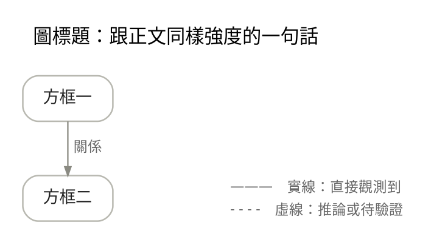
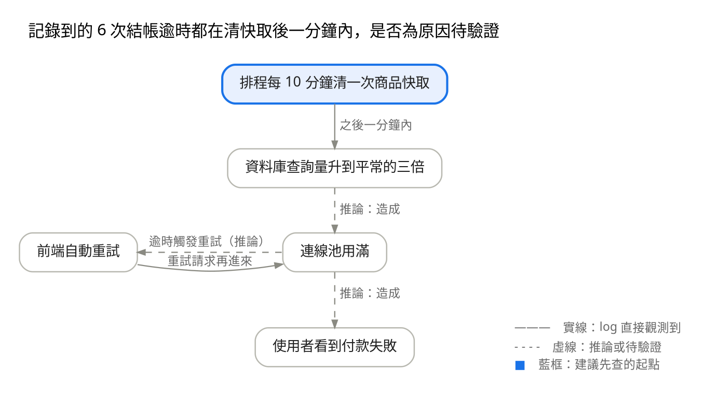
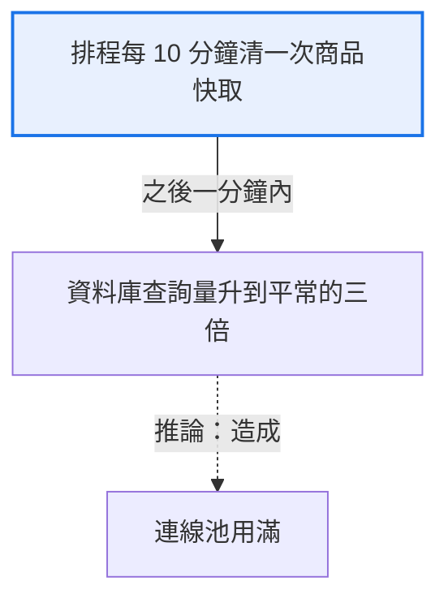
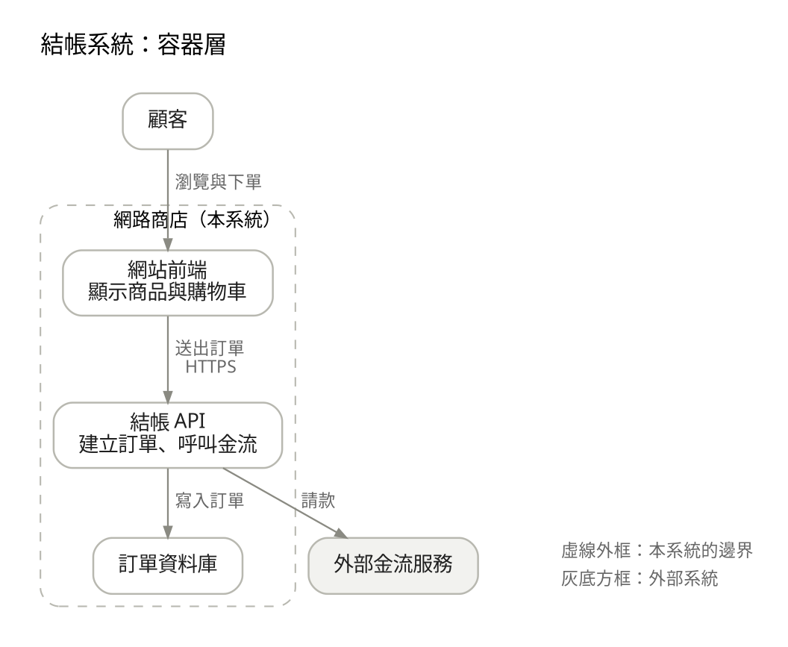

# 畫圖：平台與寫法

要在文件裡畫圖時讀。什麼時候畫、圖要遵守的寫作規則（五種限制、圖例、圖與文字分工）在 `SKILL.md` 第 3、4 節，正反例在 `examples.md`「圖的寫作面」。本檔只管在哪個平台用什麼語法畫得出來、怎麼畫得清楚。

## 目錄

1. 先看平台
2. CodiMD
3. HackMD.io
4. GitHub
5. 畫不出圖的環境與平台不明時
6. Graphviz 寫法與共用樣板
7. Mermaid 寫法
8. 架構圖：由整體逐層放大
9. 數字圖表與時間線
10. 文字替代
11. 渲染驗證

## 先看平台

| 平台 | 會畫成圖的區塊 | 建議 |
| --- | --- | --- |
| CodiMD（自架） | `graphviz`、`mermaid` 等 | 有分支、迴圈的因果圖用 Graphviz，Mermaid 依站台內建版本寫 |
| HackMD.io | `graphviz`、`mermaid` 等 | 版本未公開，用新舊版都能畫的保守寫法，貼上後實看 |
| GitHub | `mermaid`，不畫 `graphviz` | 用 Mermaid |
| Teams、郵件、純文字 | 都不畫 | 用文字。真的需要圖，附圖片並給文字替代 |
| 平台不明 | 不確定 | 預設用文字。需要圖時可附 Mermaid 並給完整文字替代 |

同一份文件會貼到多個平台時，以最舊、最受限的那個為準。

## CodiMD

**內建版本**：2.5.x 內建 Mermaid 8.10.2，2.6.x 改為 Mermaid 11.5.0，兩版的 viz.js（Graphviz 的瀏覽器版）都是 2.1.2。來源是各版的 package.json：[2.5.4](https://raw.githubusercontent.com/hackmdio/codimd/2.5.4/package.json)、[master](https://raw.githubusercontent.com/hackmdio/codimd/master/package.json)。不確定站台是哪一版時，Mermaid 用 8.10 相容寫法。

**區塊名稱**以 [CodiMD 支援語法說明](https://hackmd.io/@codimd/extra-supported-syntax) 為準，包括 `graphviz`、`mermaid`、`sequence`、`flow`、`abc`、`vega`、`plantuml`。

- PlantUML 要另外架伺服器，自架的站台不一定有設定。
- `sequence` 與 `flow` 能畫的版面太簡單，一般不用。
- Graphviz 的區塊名稱寫 `graphviz`。`dot`、`gv`、`diagram` 這類名稱不一定會畫成圖，讀者只會看到程式碼（`check-doc-shape.sh` 會提醒）。

**為什麼 CodiMD 上的因果圖選 Graphviz**（實測理由，只適用這個平台，不是所有平台的首選）：

- 新舊版內建同一版 viz.js，畫出來一樣。Mermaid 8.10 與 11.5 畫出來不同，舊版遇到部分寫法會整張解析失敗。
- 箭頭文字放在線旁，不壓在線上。
- 能畫圖內標題與圖例，Mermaid 8.10 兩者都沒有。
- 能指定同一層方框的左右順序，版面最接近手繪。

**實測狀態**：viz.js 2.1.2 在 Linux 的 Chromium 畫中文方框沒有超框。macOS 上貼進一個 CodiMD 站台初步看過也沒有超框，但版本未確認，可追溯的紀錄待補（見 `design-decisions.md`「平台與渲染細節」）。換字型或系統時要再看一次。

## HackMD.io

HackMD.io 是另一個服務，沒有公開內建的 Mermaid 與 viz.js 版本，不能套 CodiMD 的版本號。

- `graphviz` 與 `mermaid` 區塊都能用。
- Mermaid 用 8.10 相容寫法，新舊版都畫得出來。
- 貼上後實看一次再交付。

## GitHub

GitHub 的 Markdown 會把 `mermaid`、`geojson`、`topojson`、`stl` 區塊畫成圖，`graphviz` 區塊只顯示成程式碼（[GitHub Docs: Creating diagrams](https://docs.github.com/en/get-started/writing-on-github/working-with-advanced-formatting/creating-diagrams)）。

- 用 Mermaid。GitHub 內建的版本會跟著更新，本檔不寫死。
- 同一份文件也要貼到 CodiMD 2.5.x 時，用 8.10 相容寫法。

## 畫不出圖的環境與平台不明時

- **Teams 訊息、郵件、純文字**：程式碼區塊不會變成圖。關係用條列或表格寫清楚。真的需要圖，附渲染好的圖片，正文給文字替代。
- **平台不明**：預設用文字。需要圖時可附 Mermaid，多數平台會畫，畫不出來時至少是可讀的程式碼，並給完整文字替代。這是可調預設，知道平台後照該平台的建議改。

## Graphviz 寫法與共用樣板

### 共用樣板

下面的配色、字型、邊距與圖例位置是本地設計決定，不是外部標準。適用內建 viz.js 2.1.2 的環境（CodiMD、HackMD.io 預期相同），在 viz.js 2.1.2 實測過。可依平台與讀者調整。



### 寫法要點

以下都在 viz.js 2.1.2 實測過，`splines=ortho` 那條除外。

- **標題**用 `graph [label="標題\n ", labelloc=t, labeljust=l]` 畫在左上角，`\n ` 讓標題跟方框隔開。標題跟正文同樣受五種限制約束：觀測範圍要寫進標題（例如「6 次有完整記錄的當機」，不是「當機都」）。方框不放材料沒逐一確認的標籤（例如錯誤類型）。只觀測到一次的先後，用文字標「觀測到一次」，不畫成已確認的機制。
- **預設樣式**寫在 `node [...]` 與 `edge [...]`，個別方框只寫文字。字型寫成清單，輸出成 SVG 時會變成 CSS 字型清單。
- **文字**一律加雙引號，換行用 `\n`。箭頭文字前加兩個空白（`label="  推論"`），跟線拉開距離。
- **虛線**用 `style=dashed`。線型的意思一定要寫在圖例，箭頭文字也要說得出是時間先後、相關還是因果假說。
- **重點色**只標讀者最該注意的那一格：`style="rounded,filled", fillcolor="#e8f0fe", color="#1a73e8", penwidth=2`，圖例說明它代表什麼。
- **指定同一層與左右順序**：`{ rank=same; H; C; D }` 讓三個方框同一層，再加 `{ rank=same; edge [style=invis]; H -> C -> D }` 用隱形連線決定由左到右的順序。只寫 `rank=same` 時，左右順序由 Graphviz 決定，迴圈的方框常跑到不想要的那一側。
- **兩個方框之間的來回迴圈**：兩條線都寫成同一個方向，反方向那條加 `dir=back`。例如 `H -> C [dir=back]` 畫出來是 C 指向 H，左右順序就不會被打亂。
- **圖例**用 `shape=plaintext` 的方框放 HTML 表格標籤，每列一行說明，再用 `rank=same` 加 `[style=invis, minlen=2]` 的隱形連線擺到最後一層的右側，`minlen` 越大離得越遠。
- **中文方框的邊距**留寬一點（`margin="0.22,0.1"`）。viz.js 用內建字寬估算方框大小，換字型或系統時要看一眼有沒有超框。
- **不用 `splines=ortho`**：Graphviz 文件註明直角連線不處理箭頭文字（未實測）。

### 範例

情境（虛構）：一個網路商店的結帳 API 間歇逾時，時間跟清快取的排程吻合，因果還沒驗證。



圖下的解讀只要一句：「左側迴圈是疑似的惡化機制：逾時可能觸發前端重試，重試再推高查詢量，下一步關掉自動重試比對逾時次數。完整文字說明見查證用的部分『圖的文字版』。」

## Mermaid 寫法

以 Mermaid 8.10 為下限，CodiMD 2.5.x 內建 8.10.2、2.6.x 內建 11.5.0，下面的寫法兩版都實測過。

- **開頭**寫 `graph TD`（由上往下）或 `graph LR`（由左往右）。節點代號用英數，方框文字放在代號後面。
- **中文一律加雙引號**，方框與箭頭文字都是：`A["重啟後仍鎖住"]`、`-->|"已驗證有效"|`。8.10 遇到沒加引號又含全形標點（，（）：）的文字，整張圖會解析失敗。
- **線型**：實線 `-->`、虛線 `-.->`。方框內換行用 `<br/>`。
- **重點色**用 `classDef 名稱 fill:…,stroke:…` 加 `class 代號 名稱`。
- **8.10 沒有的語法不要用**：`---` 開頭的 frontmatter（title、config）、`@{ shape: … }`、引號內的 Markdown 字串。設環境變數 `WRITING_STYLE_MERMAID_TARGET=8.10` 時，`check-doc-shape.sh` 會提醒 frontmatter、`@{ shape: … }` 與沒加引號的全形標點，引號內的 Markdown 字串要自己檢查。
- **配色**：預設是紫色方框、彎曲連線。第一行加 init 指令改成中性配色：`%%{init: {"theme": "base", "themeVariables": {"primaryColor": "#ffffff", "primaryBorderColor": "#b8b8b0", "lineColor": "#8a8a82", "edgeLabelBackground": "#ffffff"}, "flowchart": {"curve": "linear"}}}%%`。init 裡的字串只能用雙引號，混用單引號整段會被忽略。11.5 會忽略其中的 `curve: linear`，連線仍是彎的。
- **連線穿過不相關的方框**：8.10 沒有隱形連線語法，可以加一條普通連線，再用 `linkStyle 第幾條 stroke-width:0px` 藏起來，把方框拉到想要的位置，並用 `%%` 註解說明用途。
- **沒有圖例與圖內標題**：標題寫在圖上方的正文，圖下那句解讀交代實線與虛線的意思。



## 架構圖：由整體逐層放大

架構圖依 [C4 模型](https://c4model.com/) 由整體逐層放大，每張圖只畫一層：

1. **系統脈絡**：這個系統、誰在用、跟哪些外部系統往來。所有讀者都看得懂，通常先給這張。
2. **容器**：系統裡可以各自部署或執行的單位（網站、API、資料庫、佇列）與它們之間怎麼溝通。
3. **元件**：單一容器裡的主要模組。
4. **程式碼**：通常不畫，需要時用工具產生。

- 從第 1 層開始，讀者的任務需要才往下放大一層。
- 每張圖的標題寫明範圍與層級，例如「結帳系統：容器層」。
- 方框寫名稱與一句職責，需要時加技術。連線寫它在做什麼，需要時加協定，例如「送出訂單，HTTPS」。
- C4 不規定形狀與顏色，自訂時附圖例說明方框種類與線型。
- Graphviz 用 `subgraph cluster_名稱 { label="…" }` 畫系統邊界。Mermaid 8.10 沒有 C4 專用語法，用一般的 `graph` 與 `subgraph` 畫。



## 數字圖表與時間線

- **圖表**：要看趨勢、模式或例外時用。要查確切數字用表格，兩者可以並用。基本原則：標題說出要看什麼、軸有單位、要比較的數列用同一個刻度、顏色不單獨承載意義、附資料來源與期間。多數 Markdown 平台不會畫數字圖表，通常附圖片加資料表。細節不在本 skill 範圍。
- **時間線**：只用在強調先後的事件，三件以上才用，步驟用編號清單。Markdown 裡用「時間、事件」兩欄的表格最穩。Mermaid 的 `timeline` 圖 8.10 沒有。

## 文字替代

需要解讀的圖要有兩層說明：

- **簡短說明**：圖下一句解讀，說出圖的重點與線型的意思，留在主線。
- **完整文字替代**：複雜圖才需要。依圖的走向逐一交代方框與箭頭的關係與強度，迴圈與分支要明講，用條列或表格都可以。

完整文字替代的預設位置是查證用的部分或圖下的摺疊區，圖旁一句指過去。這是可調預設，依平台與讀者調整。部分讀者完成任務必需的內容，不放進標「不必讀」的地方。

上面範例的文字版：

```markdown
- 排程每 10 分鐘清一次商品快取，之後一分鐘內資料庫查詢量升到平常的三倍（log 觀測）。
- 查詢量升高造成連線池用滿（推論）。
- 逾時讓前端自動重試（推論），log 看得到重試請求再進到連線池（觀測），形成迴圈。
- 連線池用滿造成使用者看到付款失敗（推論）。
- 建議先查的起點：清快取的排程。
```

## 渲染驗證

交付前確認圖真的畫得出來，而且畫得對：

- **最可靠**：貼進目標平台預覽。
- **本機**：用跟平台同版本的引擎在無頭瀏覽器渲染，例如 viz.js 2.1.2，或 Mermaid 8.10.2 與 11.5.0（分別裝在不同資料夾）。印出錯誤就是語法錯，沒錯再截圖看畫面。
- **要看的項目**：整張有沒有畫出來、中文是否超框、箭頭文字有沒有壓線或重疊、窄視窗、放大、對比、黑白列印時線型與圖例還分得出來、複製貼上後文字替代還在。

AI 看不到實際畫面時，交付訊息標「畫面待驗」，並列出上面要看的項目，不假裝已經檢查過。
